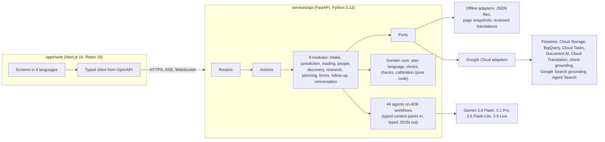

# AfterLedger

**Finds what a person left behind, and prepares every claim, in any country and in the family's own language.**

When someone dies, the family has to find every account, policy, pension and debt, prove who they are to each
institution, fill each institution's own forms in its own language, and chase each one past its deadline. The
money that defeats them stays unclaimed. AfterLedger is an agent system that does that work with the family:
it reads their papers, finds what nobody listed, researches the rules that apply (with the regulator's own words
as evidence), prepares each claim pack, and follows every claim until it is paid.

This repository is a working prototype for the **AI Builder Cup JAPAC 2026** (BFSI theme), built on Google Cloud
with Gemini and the Agent Development Kit.

| Why it matters | Source |
|---|---|
| ₹1,12,564 crore of unclaimed bank deposits sat in the RBI's Depositor Education and Awareness Fund at 31 March 2026. | [RBI Annual Report 2025-26, Schedule 2](https://rbidocs.rbi.org.in/rdocs/AnnualReport/PDFs/12ACCOUNTS290520267DCFE3C4E9DA4C808B5779DCC11AAEE4.PDF) |
| Of 59,940 claims to India's IEPF Authority in 2024-25, 12,749 were approved; the old process took about three years and 25 steps. | [EAC-PM case study, May 2026](https://eacpm.gov.in/wp-content/uploads/2026/05/Case-study-on-IEPFA.pdf) |
| Japan recorded 1,605,378 deaths in 2024, the most since records began. | [MHLW vital statistics 2024](https://www.mhlw.go.jp/toukei/saikin/hw/jinkou/kakutei24/dl/02_kek.pdf) |
| US executors take an average of 20 months to settle a person's affairs, and 54% pay costs from their own money. | [Empathy, Grief Tax 2025](https://www.empathy.com/blog/what-loss-really-costs-key-takeaways-from-the-grief-tax) |

## What it does for a family

- **Tell the story** by voice or text, in their own language. One question at a time, kindly; a summary to confirm.
- **Read every paper twice, by different methods** (the OCR text layer and the page image), compare by code, and
  look closely only where the two disagree. Certainty labels come from measured accuracy, never from a model's
  own say-so; values that still need a person become a short question for the family.
- **Find what nobody listed**: a ₹436 debit every May is a government life cover worth ₹2,00,000; a payment that
  continued after the death is a mandate to stop. Each lead is investigated, argued against by a critic, and
  marked by the family.
- **Work out whose rules apply** to each holding, across countries, and say plainly when two countries' laws
  disagree, with both sources shown.
- **Plan each claim from verified rules**: every step, paper and deadline carries the regulator's or
  institution's own words, word for word from its page, and the date it was checked.
- **Prepare the claim pack**: the institution's own forms, filled in its script and format and read back from
  the PDF; a covering letter in the institution's language, with a copy in the family's language that is
  translated back and compared before anyone signs.
- **Follow every claim**: the statutory clock, late days, and the compensation an institution owes for delay,
  with a reminder or objection letter that quotes the rule. A Today screen says what matters this morning, for
  each family member, in their language.
- **Ask anything**, typed or spoken: answers come only from the case and its sources, checked for grounding.

## The demonstration

Six fictional families, each showing something hard. Their papers, banks and insurers are invented; the
regulators, laws and quotes are real and linked to their pages.

| Family | Where | Speaks | What it shows |
|---|---|---|---|
| The Vermas | Lucknow, India | Hindi, by voice | Life cover found from a ₹436 debit; a bank five days past the regulator's limit, and the compensation it owes |
| The Satos | Osaka, Japan | Japanese | Era-year dates and katakana names; a card loan with a three-month decision; bank forms with seal boxes |
| The Clarkes | Leeds, United Kingdom | English | Each bank's own probate limit; Premium Bonds found; an objection when a bank asks for more than its rules allow |
| The Moraleses | San Antonio, United States | Spanish and English | The Social Security payment that has to go back; employer benefits; the Texas small-estate route |
| The Nairs | Kochi, India, after a death in Singapore | Malayalam and English | Holdings in two countries; CPF with no nomination; handwritten Malayalam notes read and confirmed |
| The Tanakas | Munich, Germany, with a Japanese father | German | Two countries' laws disagree about who inherits; both sources shown, and each bank's steps still prepared |

**The live challenge**: name any country, institution and situation, and watch the rules being researched: two
researchers working separately (official sources first; the country's own language first), a citation check
that drops any quote not found word for word on its page, an adjudicator, a compiled plan checked by code (and
against a hand-checked gold plan where one exists), and a letter in the institution's language.

The interface is in English, Hindi, Japanese, Spanish, Malayalam and Arabic (right to left), and each family
member sees their own greeting and tasks in their own language.

## How it is built



- **Agents propose; code decides.** Every agent gets one JSON context pack and answers in a typed schema. Exact
  work is code: dates, money, clocks and compensation, running balances, plan routes, quote checks, read-backs of
  filled forms, and the numbers in every letter.
- **Two of everything that matters**: two readings of each paper, two researchers for each rule, a critic for
  each lead, a back-translation for each family copy.
- **Ports and adapters.** The same application runs offline (scripted responses for every agent, local files,
  page snapshots, reviewed translations) or live (Gemini and Google Cloud services, each switched on separately).
  The Evaluation page says which parts of the running copy are live, and nothing offline is presented as live.
- **The plan language.** Rules become small typed programs (variables, documents, clocks, steps with conditions)
  that agents compile from verified assertions and code runs for each family. See
  [docs/architecture.md](docs/architecture.md) and the [decision records](docs/adr).

## Run it on your computer

You need Python 3.12 with [uv](https://docs.astral.sh/uv/), Node.js 22.12 or later with
[pnpm](https://pnpm.io/) 10, and git. The same commands work in Windows PowerShell, macOS and Linux.

```bash
python tools/dev.py setup     # installs the API and the web app, creates .env (offline mode)
python tools/dev.py demos     # builds the six demo cases once, offline (about three minutes)
python tools/dev.py dev       # API on http://localhost:8080, web app on http://localhost:3000
```

Open http://localhost:3000. Everything runs offline: no Google Cloud project, no keys and no network.

Other commands: `python tools/dev.py test` (the fast tests; `--all` adds the end-to-end runs over the six
families), `check` (everything CI checks), `e2e` (browser tests with Playwright and axe), `eval` (the evaluation,
see [docs/evaluation.md](docs/evaluation.md)) and `contracts` (regenerate the API client). See
`python tools/dev.py --help`.

## Live runs, and deploying to Google Cloud

- **Live run on your computer** with Gemini (an AI Studio key or Agent Platform) and, optionally, Document AI,
  Cloud Translation, check grounding and the live web: [docs/runbooks/live-run.md](docs/runbooks/live-run.md).
- **Deploy** the API and web app to Cloud Run, with Firestore, Cloud Storage, BigQuery and Cloud Tasks, using
  Terraform or the step-by-step commands: [docs/runbooks/deploy-gcp.md](docs/runbooks/deploy-gcp.md).
- **The live run of 15 October**: all six families and both challenge countries on real Gemini, with every Google
  Cloud service live. Its results, costs and limits are in [docs/evaluation.md](docs/evaluation.md), section 5.

## What is real, and what is not

- Every family, person, bank, insurer and paper in the demonstration is **fictional**, and the app labels each
  demo case as synthetic. Regulators, laws and their quotes are **real**, each linked to its page with the date it
  was checked.
- In an offline run the agents answer from **scripted responses** (deterministic, derived from each family's
  truth file and the knowledge fixtures). They exist so the whole flow can be built and tested without a model;
  agent quality is measured only in a live run. The app and the evaluation report say which kind of run made
  what you see.
- Certainty labels come from tables **refitted on 15 October** from the six cases a live model prepared, where a
  group held at least 20 values; smaller groups keep their hand-set starting values, and the Evaluation page says
  so. See [docs/evaluation.md](docs/evaluation.md).
- Offline, text in the family's language comes from a **reviewed translation table** that covers the demo
  stories; other server-written words stay in English until a live run (Cloud Translation, reviewed entries
  first).
- Where a rule is not verified, the app says so. Offline, the Vermas' family pension plan is an unverified draft
  that starts by asking the pension office in writing; a live run researches the UP Treasury's own procedure in
  its place.
- Security hardening, pricing and per-country regulation of the service itself are out of scope for this
  prototype.

## Repository

```
apps/web/              Next.js web app (screens, components, messages in 6 languages, tests)
services/api/          FastAPI service: domain core, modules, agents and prompts, adapters, tests
packages/contracts/    OpenAPI document and the generated TypeScript types
data/knowledge/        Assertions with quotes, plans, forms, institutions, page snapshots, translations
data/families/         The six fictional families: papers, timelines and truth files
data/eval/             Gold plans, research fixtures and clock test vectors
infra/                 Terraform, Cloud Build and the deploy script (each Dockerfile sits beside its service)
docs/                  Architecture, decision records, evaluation and runbooks
tools/dev.py           One entry point for setup, running, testing and checking
```

## Licence

MIT. See [LICENSE](LICENSE).
