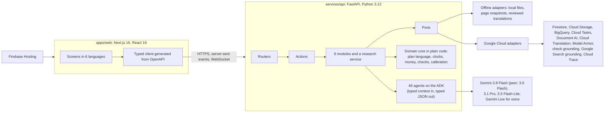

# AfterLedger

**Find everything they left behind. Settle it one claim at a time.**

When someone dies without having arranged for their assets to reach the right people (a nominee named on each
account and policy, a will, a record of what they held), their family is left to find every account, policy, pension
and debt, and to claim each one from an institution with its own forms, rules and deadlines. AfterLedger is a team
of AI agents that does this work with the family. It reads the papers they already have, in any language, finds the
accounts and policies nobody listed, prepares each claim from the institution's current rules with the source behind
every line, and follows every claim until it is paid.

**Try it at [afterledger.web.app](https://afterledger.web.app).** Three sample families open without an account.

Built on Google Cloud with Gemini and the Agent Development Kit, for the Google Cloud AI Builder Cup JAPAC 2026
(BFSI theme).

## Why it matters

Where no such arrangements were made, the bank accounts, insurance policies, pensions, investments and debts that
nobody listed are each held by an institution with its own forms, documents and deadlines, often in another language
or another country. Money is lost not because it is not owed, but because nobody knows it exists, or how to claim
it.

| The scale of it | Source |
|---|---|
| LIC alone held ₹7,318.50 crore of unclaimed policy money, and inoperative provident fund accounts ₹9,330.56 crore, on 31 March 2026. | [Lok Sabha answer, 20 July 2026 (via Outlook Money)](https://www.outlookmoney.com/personal-finance/lic-unclaimed-funds-cross-rs-7300-crore-epfo-inoperative-accounts-at-rs-9330-crore) |
| ₹1,12,564 crore of unclaimed bank deposits sat in the RBI's Depositor Education and Awareness Fund at 31 March 2026. | [RBI Annual Report 2025-26, Schedule 2](https://rbidocs.rbi.org.in/rdocs/AnnualReport/PDFs/12ACCOUNTS290520267DCFE3C4E9DA4C808B5779DCC11AAEE4.PDF) |
| About 1 in 7 people in the United States has unclaimed property held by a state. | [NAUPA, What is unclaimed property](https://unclaimed.org/what-is-unclaimed-property/) |
| In a 2025 survey of bereaved people in the US, executors took an average of 20 months to settle a person's affairs, and 54% of those surveyed paid post-loss costs from their own money. | [Empathy, The Grief Tax 2025](https://www.empathy.com/blog/what-loss-really-costs-key-takeaways-from-the-grief-tax) |
| Japan recorded 1,605,378 deaths in 2024, the most since records began. | [MHLW vital statistics 2024](https://www.mhlw.go.jp/toukei/saikin/hw/jinkou/kakutei24/dl/02_kek.pdf) |
| An Indian bank must settle a deceased customer's claim within 15 days of complete papers, or pay compensation for every day of delay. Only a family that knows the rule can hold the bank to it. | [Reserve Bank of India, settlement of claims of deceased customers](https://rbidocs.rbi.org.in/rdocs/notification/PDFs/170MD.PDF) |

## What makes it different

- Existing tools search databases, notify organisations, or are concierge services paid a share of the estate. None
  reads the family's own papers to find what nobody listed.
- AfterLedger infers from the lines of a statement: a ₹436 debit every May is the premium of a government life cover
  worth ₹2,00,000.
- It prepares each institution's own forms, covering letter, document list and deadline from the regulator's current
  rules, and drafts the objection when an institution asks for more than its rules allow.
- It works in the family's languages, by voice or text, and across borders, and it researches any country's rules
  live, quoting the official page.

## Try it live

Open [afterledger.web.app](https://afterledger.web.app). The three sample families need no account:

| Family | Where | Spoken with | What it shows |
|---|---|---|---|
| The Vermas | Lucknow, India | Hindi, by voice | Life cover found from a ₹436 debit; a bank five days past the regulator's limit, and the compensation it owes |
| The Satos | Osaka, Japan | Japanese | Era-year dates and katakana names; a card loan with a three-month decision; bank forms with seal boxes |
| The Nairs | Kochi, India, after a death in Singapore | Malayalam and English | Holdings in two countries; CPF with no nomination; handwritten Malayalam notes read and confirmed |

The samples are fictional families, prepared in advance with scripted answers standing in for the AI models. They
are read only: every page opens, and you can ask them questions.

A short tour of the Vermas' case:

1. **Today**: Narmada Bank is five days past the regulator's 15-day limit, and code works out the ₹835 it owes for
   the delay.
2. **Leads**: a ₹436 debit every May turns out to be PMJJBY, a government life cover of ₹2,00,000 that nobody had
   listed.
3. **Plans**: tap **Why?** on any step to read the Reserve Bank of India's own words, from the page they came from,
   with the date they were checked.
4. **Packs**: the bank's own forms, filled in and read back from the PDF, and a covering letter whose Hindi copy was
   translated back and compared with it.
5. Switch the language to **हिन्दी** to see the case as the family sees it.

To go further, create an account. Start a case of your own by voice or text, add papers (PDFs or phone photos), and
Gemini works on it live. Signed in, you can also name any country, with a bank and a situation if you like, and watch
its rules being researched. Each case is open only to the account that started it, and to the site's admin.

## What it does for a family

- **Listens.** The family tells the story by voice or text, in their own language. AfterLedger asks one question at
  a time, only what helps, and writes a one-page summary for them to confirm.
- **Reads every paper twice.** PDFs and photos in any script are read by two different methods (the page's text,
  from the PDF itself or by OCR, and the page image) and compared by code. A closer look settles disagreements, and
  a statement's running balance settles each line. Only values that are still uncertain become a question for the
  family.
- **Finds what nobody listed.** Payments are grouped by payee and rhythm: a yearly premium points to a policy
  nobody mentioned, and a payment that continued after the death is a mandate to stop. An investigator proposes what
  each one means, a critic argues against it, and every lead carries a certainty label until the family marks it.
  It can only find what the papers point to (see [Limits](#limits)).
- **Works out whose rules apply** to each holding, across countries. Where two countries' laws disagree, both are
  shown with their sources, and nothing is decided by a model.
- **Plans each claim from the rules themselves.** In a verified plan, every step, paper and deadline carries the
  regulator's or institution's own words, quoted from its page with the date it was checked. A country or
  institution the knowledge base does not cover is researched live: two researchers work apart (official sources
  and the country's own language first), every quote must be found word for word on its page, an adjudicator
  settles differences, and code checks the compiled plan. What is found is kept for the next family.
- **Prepares the claim pack.** The institution's own forms, filled in its script and format and read back from the
  PDF, and a covering letter in the institution's language, with a copy in the family's language that is
  translated back and compared before anyone signs.
- **Follows every claim.** Code works out each statutory clock, how many days an institution is late and the
  compensation it owes. Reminders and objections quote the rule, and every number in a letter must be in the case.
  Replies are read against the plan.
- **Gives the institution a desk.** The family can share a claim with the bank or insurer handling it: a link,
  valid for 31 days, to a page that shows the claim against the regulator's checklist, paragraph by paragraph.
  Staff can record the settlement or ask for something else. A request reaches the family read against the rules,
  and one the rules do not allow gets an objection letter that quotes them.
- **Leaves the decisions to the family.** Nothing an institution says changes a claim until the family confirms
  it: a reply that says the claim was paid, or a settlement recorded on the desk, waits for "Yes, it arrived".
- **Shows each person their day.** Today lists the few things that need each family member, in their own language,
  with the deadlines ahead and what is still unsure.
- **Answers questions**, typed or spoken, only from the case and its sources, checked for grounding. On the live
  site, spoken questions are answered through the Gemini Live API.

The interface is in English, Hindi, Japanese, Spanish, Malayalam and Arabic (right to left), on phones and
laptops.

## How a case moves

Nine stages that overlap in practice. The family confirms things at seven points, and only what they can know.

| Stage | What AfterLedger does | What the family does |
|---|---|---|
| Tell | Asks one question at a time, by voice or text | Confirms a one-page summary |
| Whose rules | Works out which country governs each holding and each paper | |
| Read | Reads every paper twice, by different methods | Checks only uncertain values |
| Connect | Turns names across scripts into people, and payees into institutions | Confirms a match only when there is no proof |
| Discover | Finds what payments and papers point to | Marks each lead |
| Research | Finds each institution's rules in official sources, checked twice | |
| Plan | Makes one plan with owners, questions and clocks | Answers the questions and approves the plan |
| Prepare | Finds, fills, reads back and checks the forms | Reviews and signs each pack |
| Follow up | Reads replies, watches the clocks, costs every delay | Approves each letter and confirms what institutions say |

## How it is built



- **Agents propose; code decides.** Each agent gets one typed context pack and must answer in a typed schema. Code
  does everything exact: dates, money, clocks and compensation, running balances, plan routes, quote checks,
  read-backs of filled forms, and the numbers in every letter.
- **Two of everything that matters:** two readings of each paper, two researchers for each rule, a critic for each
  lead, and a back-translation for each family copy.
- **The family decides at seven checkpoints:** the summary, uncertain values, identities, leads, plan questions and
  approval, each pack, and letters and what institutions say. Certainty labels come from calibration tables, never
  from a model's own confidence: a group's label is measured once it holds at least 20 items, and set by hand until
  then.
- **Outside text is material, never instructions.** Pages, papers and replies are screened for planted
  instructions, and on the live site Model Armor also screens them for malicious links. Every model and tool call
  goes through one harness: schema checks with a re-ask, retries, the same model on another endpoint or an equal
  peer model when one is slow, a fallback to a smaller model, a budget per case, and a meter that records each
  call's tokens and cost.
- **Rules are programs.** Each rule is an assertion with a verbatim quote from its source. Plans are small typed
  programs (variables, documents, clocks, and steps with conditions) compiled from verified assertions and run by
  code on each family's facts.
- **Background work never holds up the family.** An action is saved at once, and the model work it leads to is
  queued; the screens follow each case's activity over server-sent events. Every change carries an idempotency
  key, so a request that is sent again is applied once.
- **One codebase, offline or live.** Through ports and adapters, the same code runs offline (scripted answers for
  every agent, local files, page snapshots, reviewed translations) or live (Gemini and the Google Cloud services).
  Every case records which kind of run prepared it.

| Module | What it does | Agents |
|---|---|---|
| Intake | The story by voice or text, one question at a time, and a summary to confirm | 5 |
| Jurisdiction | Which country's rules govern each holding; conflicts between laws kept, not resolved by a model | 5 |
| Reading | Triage, two independent readings, a closer look on disagreement, statement lines with running balances | 5 |
| People | Names in every script matched to people on evidence; issuers matched to institutions, unknown ones looked up | 5 |
| Discovery | Payments grouped by payee and cadence, investigated, argued against and checked for coverage; debts | 8 |
| Research | Questions planned, two researchers, a citation check, adjudication, and a plan compiled and checked by code | 5 |
| Planning | Each claim's plan run on the case's facts and explained in plain words | 1 |
| Forms and letters | Forms found, understood, filled, read back and checked; letters and their back-translated copies | 6 |
| Follow-up | Today's tasks, replies, clocks, compensation, reminders and objections | 3 |
| Conversation | Questions answered from the case and its sources | 3 |

## Built on Google Cloud

| Service | What it does in AfterLedger |
|---|---|
| Gemini on Gemini Enterprise Agent Platform, with the Agent Development Kit | Runs the 46 agents. Gemini 3.1 Pro settles disputes and compiles plans; Gemini 3.8 Flash, with Gemini 3.6 Flash as an equal peer when it is slow, does most of the reading, discovery, research and writing; Gemini 3.5 Flash-Lite runs the intake conversation and the quick sorting steps |
| Gemini Live API | Spoken questions and answers |
| Google Search grounding | Finding the official sources for a country's rules |
| Agent Search (check grounding) | Checking answers and claims against their sources |
| Document AI | OCR for scanned pages and photos (a digital PDF's own text is used as it is) |
| Cloud Translation | The family's copies, and the words the server writes, in the page's language |
| Model Armor | Screening fetched pages, uploaded papers and replies for planted instructions and malicious links |
| Cloud Run | The API and the web app |
| Firebase Hosting | The public address, with SSL and a CDN |
| Firestore | Case files, accounts, and researched rules kept for the next family |
| Cloud Storage | Papers, page images and filled forms |
| Cloud Tasks | Background work that survives a restart |
| BigQuery | One row per model call, tool call and decision, with tokens and estimated cost |
| Cloud Trace and Cloud Logging | Spans and structured logs |
| Cloud Build and Artifact Registry | Building and keeping the two images |

## How well it works

A live evaluation run compared the agents with plain code doing the same job, on six fictional test families: the
three samples, plus the Clarkes (Leeds, United Kingdom), the Moraleses (San Antonio, United States) and the Tanakas
(Munich, Germany, with a Japanese father). Every Google Cloud service was live.
[docs/evaluation.md](docs/evaluation.md) has the method, every number and the limits.

| Task | Plain code | AfterLedger |
|---|---|---|
| Reading papers (61 pages in 4 scripts) | 53 of 175 fields right (30%), on Document AI's lines | 167 of 169 fields right (99%), none wrong |
| Finding what nobody listed (hidden items in the six test families) | 13 of 21 found, 3 false leads | 17 of 20 found (the 21st was already on a paper), 11 false leads |
| Researching rules (4 questions in France and Egypt) | 0 to 2 of 8 gold points over three runs | 1 of 3 France runs matched the hand-checked gold plan; 4 of 5 runs found official sources |
| Answering questions about a case | | 7 of 7 answers grounded in the case's sources |

The checks that must always pass did. Every route that could be compared matched the hand-worked answer (28 of
28; one researched plan was not compared). The hand-worked deadline and compensation tests were exact (12 of 12: 8
due dates and 4 amounts). Every value read back from every filled form matched (258 of 258). After their repairs,
no letter held a number that is not in the case (14 letters). Every quote was found on its page (320 of 320).
Preparing a family's case from its first paper took 15 to 43 minutes and US$0.77 to US$1.95 of metered Gemini use.

The agents look further than plain code and raise more false leads, so nothing goes to an institution until the
family approves it. The six test families are both the test set and the cases the certainty labels were fitted on,
and each number comes from one run, so these numbers show the system working rather than a rate.

## Limits

- **AfterLedger finds what the family's papers point to.** If the family has no papers to add, or nothing in them
  points to an account, policy or investment, that asset can stay undiscovered. The more statements, passbooks and
  policy letters the family adds, the more there is to find, and anything the family already knows about can simply
  be told to AfterLedger and is planned like the rest.
- Where a rule is not verified, the app says so, and the plan starts by asking the institution in writing; a live
  run researches the institution's own procedure in its place.
- This is a prototype. The API runs as one instance, with write-through caches and two locks per case in memory
  ([ADR 0006](docs/adr/0006-one-api-instance.md)). Pricing, and the regulation of the service itself in each
  country, are out of scope.

## What is real, and what is not

- Every family, person, bank, insurer and paper in the samples and test families is fictional, and the app says
  so. Regulators, laws and their quotes are real, each linked to its page with the date it was checked.
- The sample cases were prepared in advance, with scripted answers standing in for the AI models. A case started on
  the live site is worked on by Gemini. Each case records which kind of run prepared it, and agent quality is
  measured only on cases Gemini prepared.

## Run it yourself

AfterLedger also runs on a laptop, offline, with scripted answers standing in for every agent, so it needs no Google
Cloud project, keys or network. You need Python 3.12 with [uv](https://docs.astral.sh/uv/), Node.js 22.12 or later
with [pnpm](https://pnpm.io/) 10, and git. The same commands work in Windows PowerShell, macOS and Linux (use
`python3` where `python` is not found).

```bash
git clone https://github.com/Nandan9911/afterledger.git
cd afterledger
python tools/dev.py setup     # installs the API (uv) and the web app (pnpm), and creates .env
python tools/dev.py demos     # builds the test families' cases once, offline
python tools/dev.py dev       # API on http://localhost:8080, web app on http://localhost:3000
```

A local copy shows all six test families and an Evaluation page with the offline evaluation. To run it with Gemini
and the Google Cloud services, see [docs/runbooks/live-run.md](docs/runbooks/live-run.md).
`python tools/dev.py --help` lists every command.

## Deploy it on Google Cloud

One script deploys the whole system to a Google Cloud project:

```bash
PROJECT_ID=your-project-id bash infra/scripts/deploy.sh
```

It turns on the services; creates Firestore, a Cloud Storage bucket, the BigQuery traces table, the Cloud Tasks
queue, the Document AI processor, the Model Armor template and the API's own service account with the roles it
uses; builds both images with Cloud Build; deploys them to Cloud Run; and, when the firebase CLI is signed in,
publishes the web app on Firebase Hosting. The result is the public site: sign-in, the three read-only samples, no
Evaluation page, and at most US$3 of optional model work per case. Terraform in `infra/terraform` creates the same
resources as code; it runs the full site, with the Evaluation page and without accounts, as a local copy does. The
steps, options and checks are in [docs/runbooks/deploy-gcp.md](docs/runbooks/deploy-gcp.md).

## Quality checks

GitHub Actions checks every push to `master` and every pull request: linting and the web app's types, a knowledge
audit that finds every quoted rule word for word on its page and checks every plan and form, a check that the
published API contract matches the code, over 300 Python tests (including end-to-end runs over the six test
families), the messages of all six languages, the web build, browser tests with Playwright and axe at laptop and
phone widths, and a Terraform check; each push to `master` also builds both container images. The same checks run
locally:

```bash
python tools/dev.py check --all   # lint, types, the knowledge audit, the API contract, messages and every test
python tools/dev.py e2e           # browser tests with Playwright and axe
python tools/dev.py eval          # the offline evaluation, with its report
```

## Repository

```
apps/web/              Next.js web app: screens, components, messages in six languages, tests
services/api/          FastAPI service: domain core, modules, agents and prompts, adapters, tests
packages/contracts/    The OpenAPI document and the generated TypeScript types
data/knowledge/        Rules with their quotes, plans, forms, institutions, page snapshots, translations
data/families/         The six fictional test families: papers, timelines and truth files
data/eval/             Gold plans, research fixtures and clock test vectors
infra/                 Terraform, Cloud Build, Firebase Hosting and the deploy and clean-up scripts
docs/                  Architecture, decision records, evaluation and runbooks
tools/dev.py           One entry point for setup, running, testing and checking
```

## Documentation

- [Architecture](docs/architecture.md): the components, modules, agents and their harness, the domain core, the
  service, the web app, voice and deployment.
- [Decision records](docs/adr): the decisions that shape AfterLedger, from ports and adapters to how a slow model
  gives way to the same model elsewhere.
- [Evaluation](docs/evaluation.md): what is measured, how, and the results.
- Runbooks: [a live run](docs/runbooks/live-run.md) and [deploying to Google Cloud](docs/runbooks/deploy-gcp.md).

## Licence

MIT. See [LICENSE](LICENSE).
